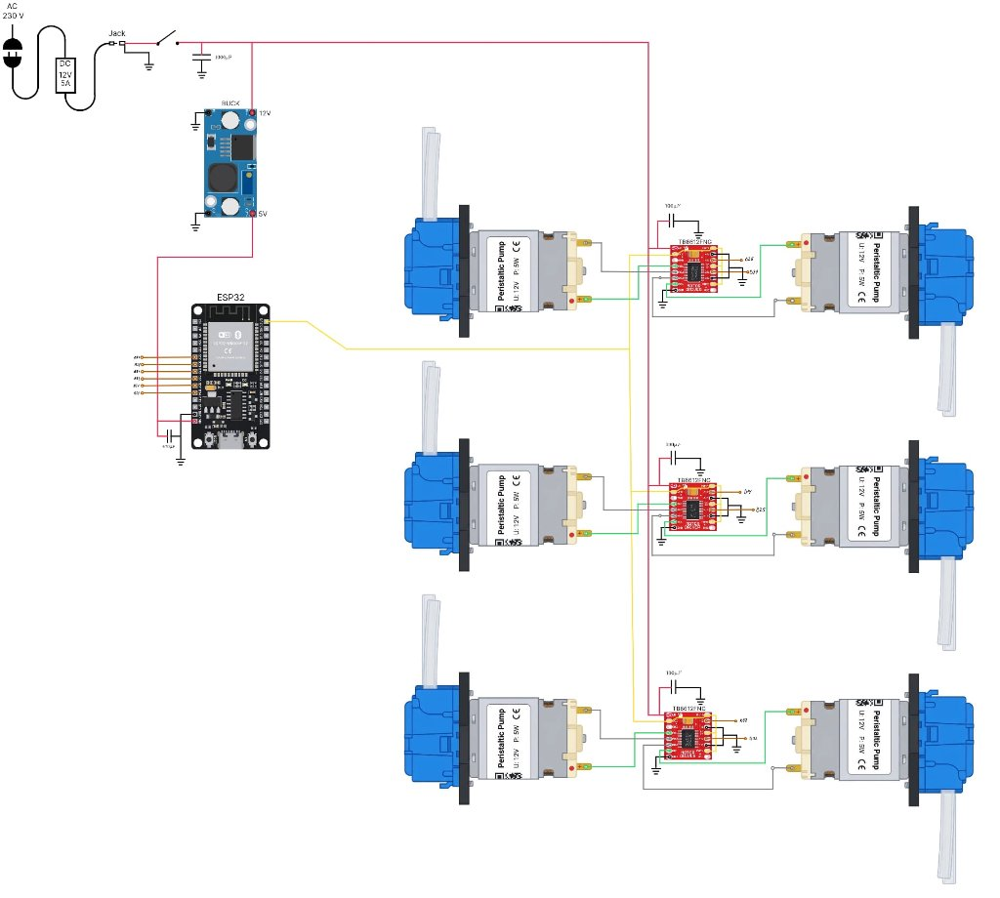

# 🍹 Șto — Dozator Inteligent de Băuturi cu 6 Canale


-orange)


Dozator automat de cocktailuri și băuturi cu **6 canale**, controlat direct de pe telefon prin scanarea unui **cod QR** (fără ecran tactil și fără conexiune la internet). Sistemul este construit în jurul unui microcontroler **ESP32**, **6 pompe peristaltice alimentare de 12V**, protecție hardware la prezența paharului și o carcasă printată 3D în PETG cu designul stilizat al lui **Șto**.

---

## 1. Conceptul proiectului

În loc să torni băuturile manual cu paharul gradat, aparatul conectează **6 furtunuri din silicon alimentar** la 6 sticle (de exemplu: vodcă, rom, suc de portocale, suc de merișoare, tonic, sirop).

- **Fără ecran scump pe aparat:** Pe carcasă este aplicat un cod QR.
- **Experiență instantanee:** Oricine scanează codul QR cu telefonul se conectează la rețeaua Wi-Fi locală generată de ESP32 și accesează meniul web găzduit direct de aparat.
- **Dozare precisă în mililitri:** Utilizatorul alege un cocktail presetat sau își combină propriile proporții, așază paharul sub duze, iar robotul toarnă automat cantitățile exacte.

---

## 2. Arhitectura sistemului

### 🛠️ Partea mecanică & igienică
- **Carcasă printată 3D (PETG):** Proiectată în CAD în forma stilizată a lui **Șto**, cu compartiment izolat pentru electronică, suporți de fixare pentru cele 6 pompe, suport pentru pahar și canal dedicat care reunește cele 6 furtunuri într-un punct comun de turnare deasupra paharului.
- **Traseu alimentar 100% igienic:** Lichidul circulă exclusiv prin **furtunuri din silicon alimentar**. Pompele peristaltice comprimă furtunul din exterior prin role, astfel încât lichidul nu atinge niciodată motorul sau componentele mecanice. La finalul serii, întregul sistem se spală rapid cu apă caldă.

### ⚡ Partea hardware & electrică
- **Alimentare principală (`12V / 5A`):** Sursă DC conectată prin jack și întrerupător general de la rețeaua de 230V AC.
- **Convertor Buck (`12V → 5V`):** Coboară tensiunea pentru alimentarea stabilă și rece a plăcii ESP32.
- **Creierul (`ESP32-WROOM-32`):** Generează propriul Access Point Wi-Fi local, găzduiește interfața web și controlează logica de dozare și siguranță.
- **Etajul de putere (`3 × TB6612FNG` + `6 × Pompe Kamoer 12V / 5W`):** Cele 3 drivere duale primesc semnale logice de 3.3V de la ESP32 și comută alimentarea de 12V către cele 6 pompe (ON/OFF într-un singur sens).
- **Protecție la prezența paharului (`Microswitch`):** Comutator mecanic montat sub suportul paharului. Dacă nu există un pahar pe poziție, pompele nu pornesc; dacă paharul este ridicat în timpul turnării, dozarea se oprește instantaneu.
- **Filtrare & stabilitate (`1000 µF`, `470 µF`, `100 µF`):** Condensatoare electrolitice plasate pe magistrala de 12V, pe alimentarea ESP32 și pe fiecare driver `TB6612FNG` pentru a absorbi vârfurile de curent la pornirea pompelor și a preveni resetarea microcontrolerului sau căderea conexiunii Wi-Fi.

### 💻 Partea software (planificată)
- **Dozare pe bază de timp calibrat:** Pentru fiecare canal se salvează în memorie debitul măsurat (`ml/s`), compensând diferențele de vâscozitate (ex. vodcă vs. sirop). Pentru o cerere în `ml`, ESP32 calculează durata exactă în milisecunde.
- **Interfață Web pentru invitați:** Meniu de cocktailuri predefinite și mod custom de combinare a ingredientelor.
- **Pagină ascunsă de Service / Administrare:**
  - **Amorsare (Priming):** Trage lichidul până la duză la schimbarea unei sticle.
  - **Calibrare rapidă (10s):** Calibrarea debitului fiecărei pompe.
  - **Spălare automată:** Ciclu de curățare simultană sau secvențială pentru toate cele 6 furtunuri.

---

## 3. Schema electrică



- 📄 Versiune PDF de rezoluție înaltă: [docs/wiring-schematic.pdf](docs/wiring-schematic.pdf)
- 📋 Lista completă de componente: [hardware/BOM.md](hardware/BOM.md)

---

## 4. Structura repository-ului

```text
.
├── cad/                  # Fișiere CAD / STL pentru carcasa 3D PETG (în lucru)
├── docs/                 # Scheme electrice (JPG, PDF) și documentație
│   ├── wiring-schematic.jpg
│   └── wiring-schematic.pdf
├── firmware/             # Codul sursă ESP32 și interfața web (în lucru)
├── hardware/             # Lista de componente (BOM) și note hardware
│   └── BOM.md
├── LICENSE
└── README.md
```

---

## 5. Roadmap

- [x] Definire concept și arhitectură sistem (6 canale, Wi-Fi + QR)
- [x] Schemă electrică completă (ESP32, 3× TB6612FNG, 6× pompe 12V, filtrare condensatoare)
- [ ] Integrare finală microswitch protecție pahar în schema electrică
- [ ] Publicare fișiere CAD / STL pentru carcasa 3D „Șto” (`cad/`)
- [ ] Implementare firmware ESP32 + interfață web + mod Service (`firmware/`)
- [ ] Testare, calibrare și ghid de asamblare pas cu pas
