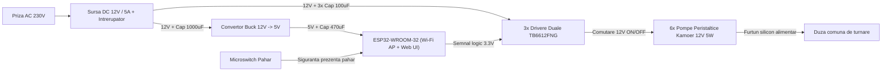

<div align="center">

# 🍹 Șto — Dozator Inteligent de Băuturi (6 Canale)

**Cocktail bot autonom controlat prin Wi-Fi și cod QR · Pompe peristaltice alimentare 12V · Protecție hardware la pahar · Carcasă printată 3D (PETG)**

<br />


[Concept](#-1-conceptul-proiectului) · [Arhitectură](#-2-arhitectura-sistemului) · [Schemă Electrică](#-3-schema-electrică) · [Componente (BOM)](hardware/BOM.md) · [Modele CAD](cad/README.md) · [Roadmap](#-5-roadmap)

</div>

---

## 🎯 1. Conceptul proiectului

În loc să măsori fiecare băutură manual cu paharul gradat, **Șto** conectează **6 furtunuri din silicon alimentar** la 6 sticle (de exemplu: vodcă, rom, suc de portocale, suc de merișoare, tonic, sirop).

- **Zero ecran scump pe aparat:** Pe carcasă este lipit un **cod QR**.
- **Acces instantaneu de pe telefon:** Oricine vine la bar scanează codul QR, se conectează automat la rețeaua Wi-Fi locală generată de **ESP32** (fără internet) și intră în meniul web găzduit direct pe microcontroler.
- **Dozare exactă în mililitri:** Alege un cocktail prestabilit sau își creează propriul mix, pune paharul sub duza comună, iar robotul toarnă cantitățile exacte.

---

## 🧱 2. Arhitectura sistemului



<table>
<tr>
<td width="50%" valign="top">

### 🛠️ Mecanică & Igienă
- **Carcasă printată 3D (PETG):** Design stilizat în forma lui **Șto**, proiectat în CAD cu compartiment izolat pentru electronică, suporți dedicați pentru cele 6 pompe, suport de pahar și canal colector care adună furtunurile într-un singur punct de turnare.
- **Traseu 100% alimentar:** Lichidul trece exclusiv prin **furtunuri din silicon alimentar** — rolele pompelor peristaltice comprimă furtunul din exterior, fără ca băutura să atingă rotițele sau motorul. Spălarea la final se face rapid cu apă caldă.

</td>
<td width="50%" valign="top">

### 💻 Software & Mod Service *(planificat)*
- **Dozare calibrată în `ml/s`:** Fiecare pompă are debitul salvat în memorie (compensând diferențele dintre băuturi fluide și siropuri dense), convertind comanda în mililitri în timp exact (`ms`).
- **Interfață Invitați:** Meniu de cocktailuri predefinite + mixer custom.
- **Pagină ascunsă de Service:**
  - **Amorsare:** Trage lichidul până la duză la schimbarea sticlei.
  - **Calibrare rapidă (10s):** Calibrează debitul fiecărui canal.
  - **Spălare automată:** Curățare pentru toate cele 6 furtunuri la finalul serii.

</td>
</tr>
</table>

### ⚡ Rezumat Hardware & Siguranță

| Bloc | Rol în sistem |
| :--- | :--- |
| **Sursă `12V / 5A` + Întrerupător** | Alimentarea generală a pompelor și etajului de control prin conector jack |
| **Convertor Buck `12V → 5V`** | Coboară tensiunea eficient pentru alimentarea stabilă a ESP32 fără încălzire |
| **`ESP32-WROOM-32`** | Generează rețeaua Wi-Fi locală, servește pagina web și comandă cele 6 canale |
| **`3 × TB6612FNG` + `6 × Kamoer 12V / 5W`** | Driverele preiau comanda de `3.3V` de la ESP32 și comută puterea de `12V` către pompe |
| **Microswitch de siguranță** | Blochează pornirea fără pahar pe suport și oprește instantaneu turnarea dacă paharul este ridicat |
| **Condensatoare (`1000 µF`, `470 µF`, `3 × 100 µF`)** | Absorb șocurile de curent la pornirea motoarelor, prevenind resetarea ESP32 și căderea Wi-Fi |

---

## ⚡ 3. Schema electrică

<div align="center">


📄 **[Descarcă schema electrică PDF (rezoluție înaltă)](docs/wiring-schematic.pdf)** · 📋 **[Vezi lista completă de componente (BOM)](hardware/BOM.md)**

</div>

---

## 📁 4. Structura repository-ului

```text
.
├── cad/
│   ├── README.md
│   └── components/                    # Modele 3D de referință (.step) pentru integrarea în CAD
│       ├── ESP32_WROOM.step
│       └── small_peristaltic_pump.STEP
├── docs/                              # Scheme electrice (JPG & PDF)
│   ├── wiring-schematic.jpg
│   └── wiring-schematic.pdf
├── firmware/                          # Codul sursă ESP32 & interfața web (în lucru)
├── hardware/                          # Lista de componente (BOM) și note hardware
│   └── BOM.md
├── LICENSE
└── README.md
```

---

## 🗺️ 5. Roadmap

- [x] Definire concept și arhitectură sistem (6 canale, Wi-Fi + cod QR)
- [x] Schemă electrică completă (`ESP32`, `3 × TB6612FNG`, `6 × pompe 12V`, filtrare condensatoare)
- [x] Modele 3D de referință pentru integrarea CAD (`ESP32_WROOM.step`, `small_peristaltic_pump.STEP`)
- [ ] Integrare finală microswitch protecție pahar în schema electrică
- [ ] Publicare fișiere CAD / STL pentru carcasa 3D „Șto” (`cad/`)
- [ ] Implementare firmware ESP32 + interfață web + mod Service (`firmware/`)
- [ ] Testare, calibrare debit și ghid complet de asamblare
